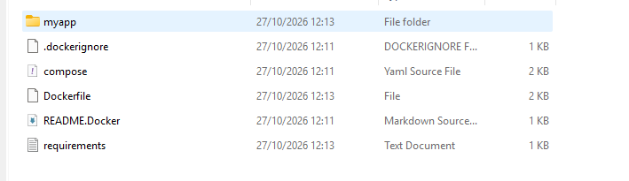

# 27/10/2026

# Docker Setup + Tutorial
1) Docker was installed and virtual machine was enabled in BIOS. This enables a linux virtual machine to run, so docker can run.
2) Docker is used for an app/scripts to:
    -> Run a particular runtime
    -> Run specific libraries
    -> Run databases
    -> Run with supporting tools adjacent
3) Running a container (in Powershell)
On the directory folder intended, ran powershell. In powershell, downloaded an image from Docker Hub and started a container from that image.
    "docker pull docker/welcome-to-docker"
    "docker run --detach --name welcome --publish 8080:80 docker/welcome-to-docker"
Running on http://localhost:8080 to see application.
Afterwards, the container was removed.
    "docker rm --force welcome"
4) Building an Image
 - "docker build --tag C:\Andre\Docker\Build and share a containerized application\getting-started-todo-app/getting-started-todo-app ."
    --tag -> Image name
    .     -> Find Dockerfile and app source in current directory
 - Create a container from image
"docker run --detach --name todo --publish 8080:3000 C:\Andre\Docker\Build and share a containerized application/getting-started-todo-app"
 - Open http://localhost:8080 -> Frontend & API running together from image built.

5) Share image
Images can be shared through a regitry.
--.
I also followed the instruction so the tutorial present in the desktop docker app. I built containers, opened images, opened multi-container applications with compose and created edits to the ejs code, using a command to allow me to do so "docker compose watch", learned how to maintain changes in files/scripts and data stored generated fro mthe "todo app", using volumes. A volume lines were introduced on the app-data and below it, sort of like if using more than one container.

6) How to access local folder from a container (using bind mounts)
    - container data is isolated from local folders
    - Bind mounts can be used.
    - Get sample application: git clone https://github.com/docker/bindmount-apps
    - How bind mounts work: Allows shareing of data directory from your host's filesystem into the container.
    - Adding bind mounts to compose: TO add bind mounts to project -> in bindmount-apps/compose.yml file uncomment the lines: 
    "   todo-app:
        # ...
        volumes:
        - ./app:/usr/src/app
        - /usr/src/app/node_modules   "
    

7) Leanred to Containerize an APP
with "Docker init." - Got a bit confused with how it works, because I didnt have an app. but i think the idea is to generate a container and all the files related to them, and also generate the files such as the yml and docker file.

# Review of HiveMQ - MQTT
 # What is it?
 Using the guide to MQTT and MQTT 5 by HiveMQ:
    Chapter 1: Introduction to MQTT
    - MQTT is a lightweight messaging protocol designed for communication in constrained networks WITH limited bandwidth and compute resources. Suited for IoT applications, where variety + quantity of devices keep growing.
    - MQTT uses binary message format for communication between clients and servers (brokers). (in contrast to other protocols that use text-based formats, such as HTTP or SMTP)
    - Using binary format, reduces message size and increases efficiency of communication
    - MQTT is easy to implement on client side.
       Benefits of MQTT:
        1. Lightweight and efficient
        2. Bidirectional communication
        3. Scalable: MQTT can scale to support millions of devices or "things" in IoT
        4. Reliable message delivery: MQTT specifies different quality of services (QoS) levels
        5. Message buffering and session Resumption
        6. Security features: MQTT supports LTS encryption for message confidentiality + authen.
Examples of applications:
    i. Smart Homes: MQTT used to connect various devices in smart home (thermostat, light bulbs, security cameras, and other appliances)
    ii. Industrial automation: MQTT used to connect machines and sensors in factories, allowing real-time monitoring and control of processes.
    iii. Agriculture: MQTT used to monitor soil moisture levels, weather conditions, crop growth.
    iv. Heathcare: MQTT used to connect medical devices and sensors, such as glucos meters and heart rate monitors, to health care providers.
    v. Transportation: MQTT used to connect cars and other transportation systems to enable real-time tracking and monitoring of vehicles.
# Chapter 2: Mastering MQTT Basics:
- MQTT are MQTT brokers and MQTT clients.
    MQTT Broker:
        a. An intermediary between senders and receivers
        b. Dispaches messages to the recipients.
        c. Maintains subscriber list
        d. Uses subscriber list to deliver messages ot relevant clients.
        e. Can buffer messages for disconnected clients
            e.1 HOW? MQTT supports three different QoS levels for message delivery:
                A- 0 (at most once)
                B- 1 (at least once)
                C- 2 (exacly once)
    MQTT Clients: 
        a. Publish messages to brokers
        b. Other clients subscribe to specific topics to recieve messages.
    Each MQTT message includes a topic, and clientes subscribe to topics of their interest.
    # HiveMQ MQTT Brokers
    HiveMQ offers:
        1) HiveMQ Professional
        2) HiveMQ Enterprise
        3) HiveMQ Cloud
        4) HiveMQ Community Edition
    # How to make MQTT Broker communicate with MQTT Client
        Step 1: Install MQTT Broker of choice^
        (ex.: Amazon AWS, Microsoft Azure, Docker, locally, on HiveMQ Cloud)
        Step 2: Connect MQTT Clients to MQTT Broker
        Varies between broker setup.
             Example 1: Using MQTT CLI for On-Premises MQTT Brokers
             Example 2: Using Cloud-Managed MQTT Broker
        Step 3: Start Publishing MQTT Messages/Subscribing to an MQTT Topic
        - Using MQTT CLI or via the console, you can start publishing MQTT messages and subscribing to MQTT topics.
    # How MQTT Client Establishes Connection with an MQTT Broker
    1. MQTT Client Initializes its MQTT library and sets up required parameters (e.g:broker's address and port)
    2. Connection to broker: Cliente establishes TCP/IP connection with MQTT broker. (default port for MQTT is 1883)
    3. Handshake: Once TCP/IP connection is made, MQTT handshake occurs. Exchanging control packets is made to establish the connetion and deal with parameters.
    4. Connect Packet: Client sends a "Connect" packet to broker, indicating intentions to make connection. This packet includes information such as client ID, connection flags, and other settings.
    5. Acknowledgment (CONNACK): Broker responds with a "CONNACK" packet, indicating whether connection request is accepted or rejected.
    6. Subscriptions (Optional): If client is a subscriber, it can then send "Subscribe" packets to broker, indicating topics it wants to subscribe to.
    7. Publishing messages: Once connection is made, clients can publish messages to topics or subscribe to topics to receive messages from other clients.
    8. Keep-Alive: TO maintain connection, clients periodically exchange "Ping" packets to confirm that the connection is still active.